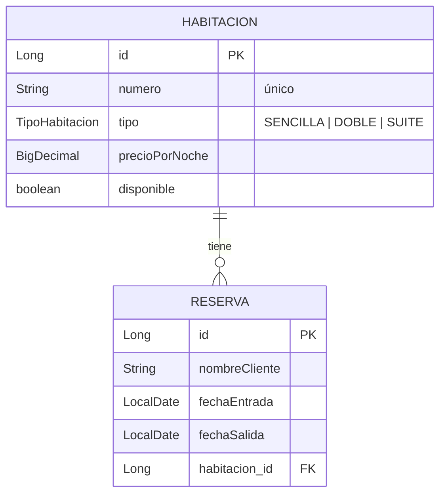

# API REST Hotel

API REST para gestionar las **habitaciones** de un hotel y sus **reservas**, hecha con Spring Boot 3 y Java 21.

**Demo en Render:** https://parcial-hotel.onrender.com

- Interfaz web: https://parcial-hotel.onrender.com
- Documentación interactiva (Swagger): https://parcial-hotel.onrender.com/swagger-ui.html
- Bienvenida de la API: https://parcial-hotel.onrender.com/api
- Habitaciones: https://parcial-hotel.onrender.com/api/habitaciones
- Reservas: https://parcial-hotel.onrender.com/api/reservas
- Reservas de una habitación: https://parcial-hotel.onrender.com/api/habitaciones/1/reservas

**Pruebas desde el despliegue:** [pruebas/PRUEBAS-DESPLIEGUE.md](pruebas/PRUEBAS-DESPLIEGUE.md) (25 de 25 exitosas) · Colección de Postman: [pruebas/Hotel-API.postman_collection.json](pruebas/Hotel-API.postman_collection.json)

> En el plan gratuito de Render el servicio se duerme tras unos 15 minutos sin uso; la primera petición puede tardar ~50 s.

## Tecnologías

- Java 21
- Spring Boot 3.5 (Web, Data JPA, Validation)
- H2 (base de datos en memoria)
- springdoc-openapi (Swagger UI)
- Bootstrap 5 + JavaScript (interfaz web)
- Maven Wrapper
- Docker (despliegue en Render)

## Arquitectura en capas

```
src/main/java/com/example/hotel
├── config       → Configuración de OpenAPI / Swagger
├── controller   → Endpoints REST (HabitacionController, ReservaController, InicioController)
├── service      → Lógica de negocio y reglas de validación
├── repository   → Acceso a datos con Spring Data JPA
├── entity       → Entidades JPA (Habitacion, Reserva, TipoHabitacion)
├── dto          → Objetos de entrada/salida (Request, Response, ErrorResponse)
└── exception    → Excepciones propias y GlobalExceptionHandler (@RestControllerAdvice)

src/main/resources/static   → Interfaz web (index.html, css/estilos.css, js/app.js)
```

Los controladores nunca exponen las entidades: reciben un `*Request` validado con Jakarta Validation y devuelven un `*Response`.

## Interfaz web

En la raíz (`/`) hay un panel para usar la API sin herramientas externas, hecho con Bootstrap 5 y JavaScript (`fetch`). Spring Boot lo sirve desde `src/main/resources/static`, así que se despliega junto con la API y no necesita Node ni configurar CORS.

- Indicadores: total de habitaciones, disponibles, reservas y valor total reservado.
- Habitaciones en tarjetas, con filtros por número, tipo y disponibilidad.
- Tabla de reservas con búsqueda por cliente y filtro por habitación.
- Formularios para crear y editar; el de reservas calcula noches y total mientras se llenan las fechas.
- Los errores de la API se muestran en la interfaz: los de validación (`400`) bajo cada campo y los conflictos (`409`) como notificación.
- Confirmación antes de eliminar, tema claro/oscuro y diseño adaptable a celular.

## Documentación interactiva (Swagger)

En `/swagger-ui.html` está la documentación generada con springdoc-openapi a partir de los controladores. Cada endpoint tiene su descripción, los códigos de respuesta posibles y un botón **Try it out** con datos de ejemplo para probarlo desde el navegador. La especificación OpenAPI en JSON está en `/v3/api-docs`.

## Modelo de entidades

Relación **1 Habitación → N Reservas** (`@OneToMany` en `Habitacion`, `@ManyToOne` en `Reserva`).



### Reglas de negocio

| Regla | Respuesta si no se cumple |
|---|---|
| Campos obligatorios, precio > 0, longitudes máximas | `400 Bad Request` con el detalle por campo |
| `fechaSalida` debe ser posterior a `fechaEntrada` | `400 Bad Request` |
| El número de habitación no se puede repetir | `409 Conflict` |
| No se puede reservar una habitación con `disponible = false` | `409 Conflict` |
| Una habitación no puede tener dos reservas con fechas cruzadas (sí se puede entrar el mismo día que otro cliente sale) | `409 Conflict` |
| Habitación o reserva inexistente | `404 Not Found` |

Al eliminar una habitación se eliminan también sus reservas (`cascade = ALL, orphanRemoval = true`).

## Endpoints

Base: `http://localhost:8080` (o la URL de Render).

`GET /api` devuelve un mensaje de bienvenida con la lista de endpoints y enlaces a la interfaz web y a Swagger.

### Habitaciones

| Método | Ruta | Descripción | Respuesta |
|---|---|---|---|
| GET | `/api/habitaciones` | Lista todas las habitaciones | 200 |
| GET | `/api/habitaciones/{id}` | Obtiene una habitación | 200 / 404 |
| GET | `/api/habitaciones/{id}/reservas` | Lista las reservas de una habitación | 200 / 404 |
| POST | `/api/habitaciones` | Crea una habitación | 201 / 400 / 409 |
| PUT | `/api/habitaciones/{id}` | Actualiza una habitación | 200 / 400 / 404 / 409 |
| DELETE | `/api/habitaciones/{id}` | Elimina una habitación y sus reservas | 204 / 404 |

### Reservas

| Método | Ruta | Descripción | Respuesta |
|---|---|---|---|
| GET | `/api/reservas` | Lista todas las reservas | 200 |
| GET | `/api/reservas/{id}` | Obtiene una reserva | 200 / 404 |
| POST | `/api/reservas` | Crea una reserva | 201 / 400 / 404 / 409 |
| PUT | `/api/reservas/{id}` | Actualiza una reserva | 200 / 400 / 404 / 409 |
| DELETE | `/api/reservas/{id}` | Elimina una reserva | 204 / 404 |

### Ejemplos

**Crear una habitación**

```bash
curl -X POST http://localhost:8080/api/habitaciones \
  -H "Content-Type: application/json" \
  -d '{"numero":"401","tipo":"SUITE","precioPorNoche":420000,"disponible":true}'
```

```json
{"id":6,"numero":"401","tipo":"SUITE","precioPorNoche":420000,"disponible":true}
```

**Actualizar una habitación**

```bash
curl -X PUT http://localhost:8080/api/habitaciones/6 \
  -H "Content-Type: application/json" \
  -d '{"numero":"401","tipo":"SUITE","precioPorNoche":450000,"disponible":true}'
```

**Crear una reserva**

```bash
curl -X POST http://localhost:8080/api/reservas \
  -H "Content-Type: application/json" \
  -d '{"nombreCliente":"Jhon Garcia","fechaEntrada":"2026-12-01","fechaSalida":"2026-12-04","habitacionId":6}'
```

La respuesta incluye las noches y el total calculados:

```json
{
  "id": 5,
  "nombreCliente": "Jhon Garcia",
  "fechaEntrada": "2026-12-01",
  "fechaSalida": "2026-12-04",
  "noches": 3,
  "total": 1350000,
  "habitacionId": 6,
  "numeroHabitacion": "401"
}
```

**Reservas de una habitación**

```bash
curl http://localhost:8080/api/habitaciones/1/reservas
```

**Eliminar**

```bash
curl -X DELETE http://localhost:8080/api/reservas/5
curl -X DELETE http://localhost:8080/api/habitaciones/6
```

### Formato de errores

Todos los errores tienen el mismo formato. Ejemplo de validación (`400`):

```json
{
  "timestamp": "2026-10-23T12:12:04.58",
  "status": 400,
  "error": "Bad Request",
  "mensaje": "La petición tiene campos inválidos",
  "ruta": "/api/habitaciones",
  "errores": {
    "numero": "El número es obligatorio",
    "precioPorNoche": "El precio por noche debe ser mayor que 0"
  }
}
```

Ejemplo de conflicto (`409`):

```json
{
  "timestamp": "2026-10-23T12:12:04.67",
  "status": 409,
  "error": "Conflict",
  "mensaje": "La habitación 101 ya tiene una reserva que se cruza con esas fechas",
  "ruta": "/api/reservas"
}
```

## Datos de ejemplo

Al arrancar se cargan desde `src/main/resources/data.sql`:

- 5 habitaciones: `101` (SENCILLA), `102` y `201` (DOBLE), `301` y `302` (SUITE; la `302` no está disponible).
- 4 reservas repartidas entre las habitaciones `101`, `102` y `301`.

Como la base es en memoria, **los datos vuelven al estado inicial cada vez que se reinicia la aplicación**.

## Cómo correr en local

Requisito: Java 21.

```bash
# Windows (PowerShell)
.\mvnw spring-boot:run

# Linux / macOS / Git Bash
./mvnw spring-boot:run
```

- Interfaz web: `http://localhost:8080`
- Swagger: `http://localhost:8080/swagger-ui.html`
- API: `http://localhost:8080/api/habitaciones`

Consola de H2 (solo en local): `http://localhost:8080/h2-console`

- JDBC URL: `jdbc:h2:mem:hoteldb`
- Usuario: `sa` — Contraseña: _(vacía)_

Para correr las pruebas:

```bash
./mvnw test
```

## Cómo correr con Docker

El `Dockerfile` es multi-stage: compila con Maven + JDK 21 y ejecuta con un JRE 21 liviano.

```bash
docker build -t hotel-api .
docker run -p 8080:8080 hotel-api
```

Para usar otro puerto, pasa la variable `PORT`:

```bash
docker run -e PORT=9090 -p 9090:9090 hotel-api
```

## Pruebas desde el despliegue

En la carpeta [`pruebas/`](pruebas/) están:

- **[PRUEBAS-DESPLIEGUE.md](pruebas/PRUEBAS-DESPLIEGUE.md):** informe de 25 pruebas ejecutadas contra la API en Render (CRUD completo, validaciones y errores 400/404/409), con cada petición, el código esperado y obtenido, y la respuesta.
- **[Hotel-API.postman_collection.json](pruebas/Hotel-API.postman_collection.json):** los mismos casos como colección de Postman, con validaciones automáticas.

Para ejecutar la colección: en Postman, **Import** → selecciona el archivo → clic derecho en la colección → **Run collection**. Las peticiones deben ir en orden, porque las primeras guardan los ids de la habitación y la reserva que crean y las siguientes los usan. Para probar en local, cambia la variable `baseUrl` de la colección a `http://localhost:8080`.

## Despliegue en Render

1. Sube el repositorio a GitHub.
2. En [Render](https://render.com): **New → Web Service** y selecciona el repositorio.
3. Render detecta el `Dockerfile` (Language: **Docker**). Elige la instancia **Free** y crea el servicio.
4. Render asigna la variable `PORT`; la aplicación la usa gracias a `server.port=${PORT:8080}`.
5. Cada `push` a `main` vuelve a desplegar automáticamente.
